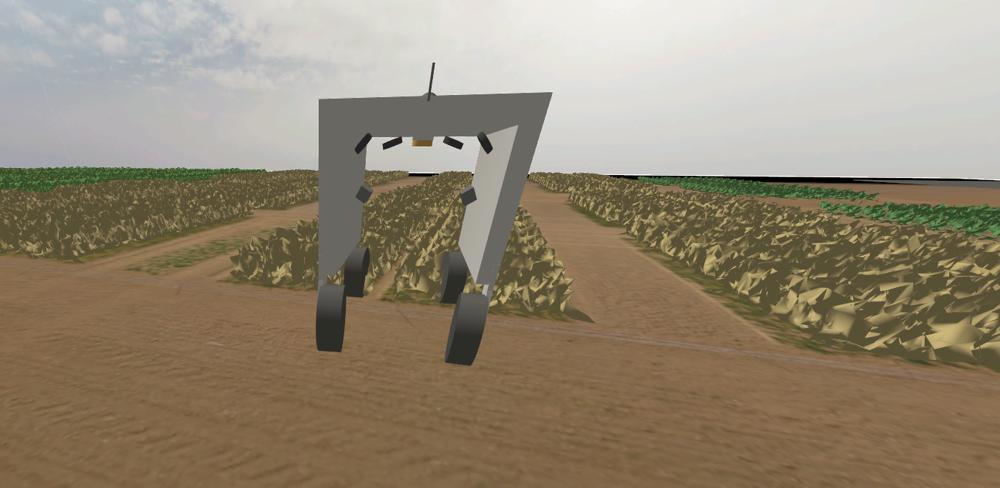
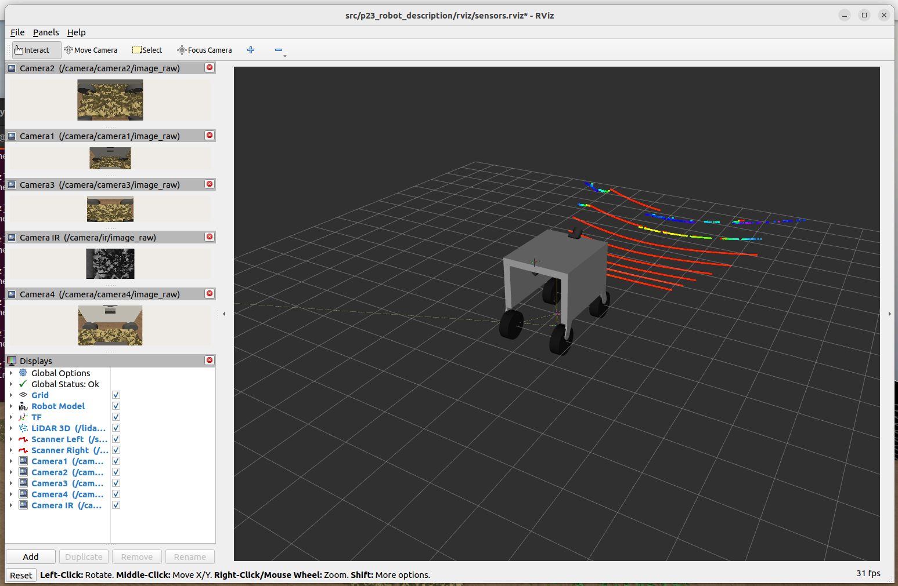
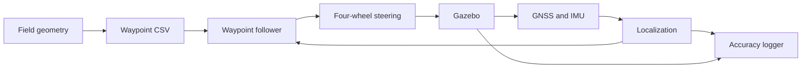
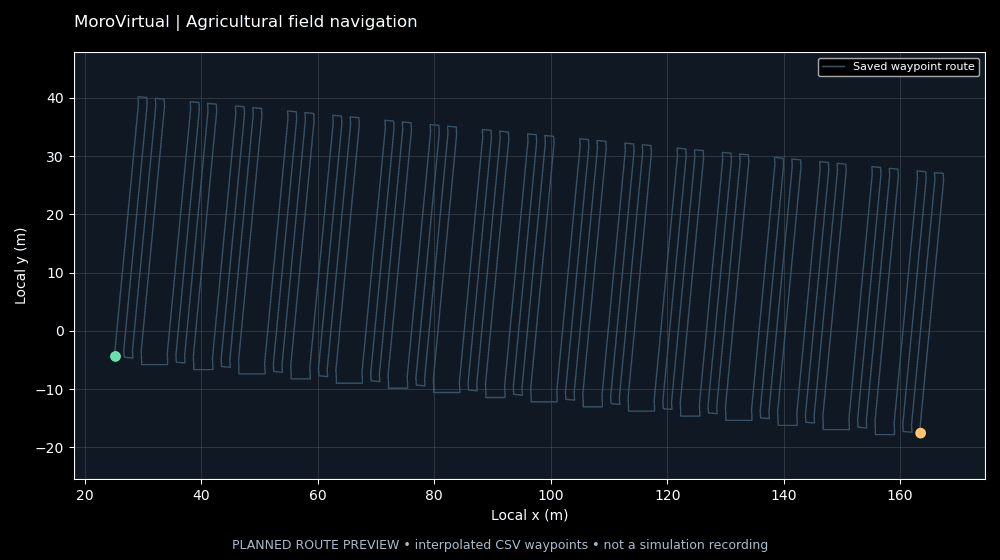
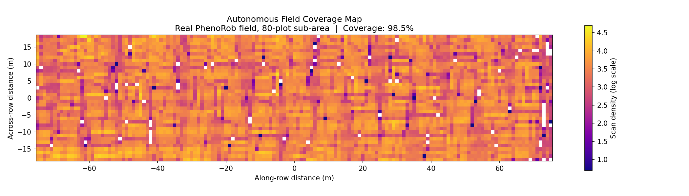
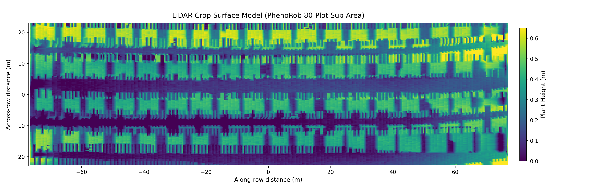

# MoroVirtual

Agricultural robot simulation with ROS 2 Humble and Gazebo Fortress. The project connects field geometry, simulated sensors, localization and waypoint navigation, with a separate UAV workflow for LiDAR scanning and crop mapping.



[Simulation video](docs/media/gazebo-field-demo.webm) · [Setup](docs/RUNNING.md) · [Technical overview](docs/PROJECT_WALKTHROUGH.md)

## Field environment

The field assets use georeferenced data from the University of Bonn's [MuST-C dataset](https://www.ipb.uni-bonn.de/data/MuST-C/). UAV terrain and orthophoto data provide the field background; plot boundaries and denser ground-level scans describe crop locations and structure.

The ground robot has four steering joints, four driven wheels, GNSS, IMU, RGB/IR cameras, LiDAR and laser scanners. Sensor data is bridged from Gazebo to ROS 2 and can be viewed in RViz.



## Navigation

1. GIS scripts calculate local plot corners and crop-row centerlines.
2. A boustrophedon planner generates alternating passes along the rows, with headland turns between them.
3. GNSS and IMU data feed the localization stack, which publishes map-frame odometry.
4. A proportional waypoint follower publishes body velocity commands on `/cmd_vel`.
5. A steering adapter converts those commands to wheel angles and velocities through `ros2_control`.



The follower runs at 5 Hz, requests 1 m/s forward speed and uses a 0.3 m arrival threshold on the estimated position. It rotates toward a target before driving, with proportional heading correction limited to ±1 rad/s. Obstacle avoidance is not part of this controller.

The saved route contains **712 waypoints** and has a polyline length of approximately **3.21 km**. The animation below shows the planned route, not recorded robot motion.



## UAV mapping

The UAV scripts cover PX4 offboard flight, downward LiDAR accumulation, grid-based coverage analysis and crop-surface mapping. They require a separate PX4 setup and compatible `px4_msgs`.





The project presentation reports **98.5% coverage of an 80-plot area**. The included plots are saved outputs; the scan has not been rerun for this repository. Coverage is the fraction of occupied grid cells inside the configured field boundary. See [results](docs/RESULTS.md) for details.

## Running the ground robot

Use **Ubuntu 22.04, ROS 2 Humble and Gazebo Fortress**. Install the dependencies in [the setup guide](docs/RUNNING.md), then build:

```bash
cd ~/MoroVirtual
source /opt/ros/humble/setup.bash
python3 scripts/check_environment.py
colcon build --symlink-install
source install/setup.bash
ros2 launch p23_bringup sim.launch.py
```

In a second terminal:

```bash
cd ~/MoroVirtual
source /opt/ros/humble/setup.bash
source install/setup.bash
ros2 launch p23_bringup ekf.launch.py
```

In a third terminal:

```bash
cd ~/MoroVirtual
source /opt/ros/humble/setup.bash
source install/setup.bash
ros2 launch p23_navigation waypoint_follower.launch.py
```

To view the sensors, source the workspace in another terminal and run:

```bash
rviz2 -d src/p23_robot_description/rviz/sensors.rviz
```

## Source layout

| Directory | Contents |
|---|---|
| `src/p23_robot_description` | Robot geometry, sensors, control interfaces and RViz configuration |
| `src/p23_gazebo_worlds` | Field worlds, terrain and plant models |
| `src/p23_bringup` | Launch files, sensor bridge, localization and steering |
| `src/p23_navigation` | Waypoint follower, accuracy logger and analysis |
| `src/p23_perception` | C++ row-error node and custom ROS message |
| `src/Viz_shapefiles` | GIS processing, row geometry and saved waypoints |
| `src/p23_uav` | UAV flight/mapping scripts and result plots |
| `scripts` | Environment check, centerline export and route preview generation |

## Evaluation and remaining work

The accuracy logger records estimated pose, simulator ground truth and waypoint events. Analysis separates localization error, terminal waypoint error and cross-track error. A complete measured ground-robot accuracy report is not included yet.

Some GIS and UAV scripts need local path configuration. Hardware bringup is unfinished. Further work includes LiDAR/RTK refinement, additional plot reconstruction and controller comparisons. [Design notes](docs/DESIGN.md) describe the current tradeoffs.

## Data and license

MuST-C data is distributed under **CC BY 4.0**. Raw raster archives are excluded from this repository; dataset references and asset details are in [docs/DATA.md](docs/DATA.md).

Code license: [Apache-2.0](LICENSE).
